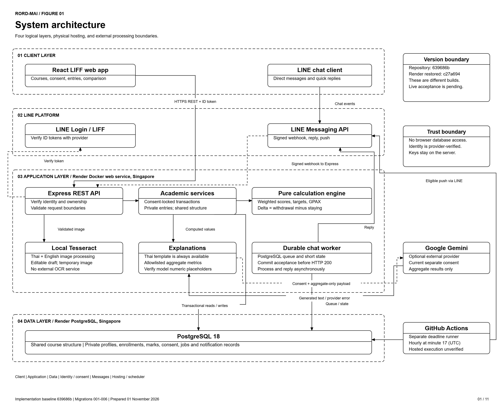
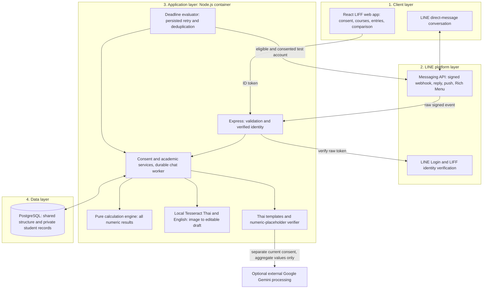

# Rord-Mai architecture

Release candidate: 30 October 2026. This describes the implemented system. Team review and same-release hosted acceptance remain pending.

## Report figures, 1 November 2026

All report figures share the requested paper style: white backgrounds, black text, outlines and arrows, Arial typography and plain divided headers. The ERD, DFD and workflow figures retain the notation appropriate to their type.

The [interactive diagram pack](diagrams/rord-mai-diagrams.html) documents repository baseline `639686b`. Download the [11-page PDF](diagrams/rord-mai-report-diagrams.pdf), or use the individual SVG/PNG files for the report. Diagram selection works without JavaScript; the optional browser export toolbar uses pinned libraries. Pre-rendered exports work offline. The DFDs follow the supplied monochrome reference style and are also available as [five editable draw.io pages](diagrams/rord-mai-dfds.drawio).

**Figure 1. System architecture.** LIFF sends REST requests directly to Express. LINE supplies identity verification and message transport. Local Tesseract is inside the Render application container; optional Gemini is external and consent-gated. GitHub Actions runs the separate deadline evaluator against PostgreSQL and LINE; it is not a timer inside the web server.

| Figure | Report asset | Purpose |
| --- | --- | --- |
| 1 | [System architecture](diagrams/exports/01-system-architecture.svg) | Logical layers, physical hosting and external processing. |
| 2 | [Core ERD](diagrams/exports/02-core-erd.svg) | Shared rules, private entries, keys and composite section integrity. |
| 3 | [Supporting ERD](diagrams/exports/03-supporting-erd.svg) | Consent evidence, attribution, durable processing and notification state. |
| 4 | [Level-0 context DFD](diagrams/exports/04-context-dfd.svg) | One system process and its external data exchanges. |
| 5 | [Level-1 DFD](diagrams/exports/05-detailed-dfd.svg) | Eight main processes and repeated aliases of the application data store. |
| 6 | [System workflow](diagrams/exports/06-system-workflow.svg) | The student journey, validation and fallback paths. |
| 7 | [Consent and data lifecycle](diagrams/exports/07-consent-lifecycle.svg) | Independent choices, optional external processing and confirmed deletion. |
| 8 | [LINE processing](diagrams/exports/08-line-processing.svg) | Durable intake and separate scheduled notification delivery. |
| 9 | [Level-2 consent DFD](diagrams/exports/09-level-2-consent.svg) | Process 2.0 decomposed into 2.1-2.6. |
| 10 | [Level-2 calculation DFD](diagrams/exports/10-level-2-calculations.svg) | Process 4.0 decomposed into 4.1-4.6. |
| 11 | [Level-2 notification DFD](diagrams/exports/11-level-2-notifications.svg) | Process 8.0 decomposed into 8.1-8.5. |

The DFD notation uses square external entities, rounded process boxes with numbered headers, open-ended stores and labelled data arrows. D1 denotes the single logical application data store backed by PostgreSQL, not an additional table or database. Its repeated symbols are aliases. The context/Level-1 external flows and each Level-2 parent/child boundary contract are checked in [dfd-model.json](diagrams/dfd-model.json). Process numbers identify decomposition, not execution order. Scheduling decisions and acknowledgement timing remain in the separate workflow figures rather than masquerade as data flows.

Figures 2 and 3 together cover 12 physical tables, 89 columns and 15 foreign keys, checked against the local schema after migrations 001-006. PK means primary key, FK means foreign key, and `?` means nullable. FK arrows point from child to parent; multiplicity labels show how many parent/child records may participate. Reference anchors repeat existing entities rather than introduce extra tables. The original [editable ERD](database/diagrams/ERD.drawio) remains available.

**Deployment evidence is separate.** The Render recovery on 1 November 2026 restarted the older `c27a694` build with a new empty database and passed public health/readiness checks. That does not establish deployment or end-to-end acceptance of `639686b`. Scheduled workflow execution, approved phone receipt, participant UAT and team review remain unverified.

## Editable logical overview

The four logical layers follow the project proposal. The LIFF browser sends authenticated REST requests directly to Express; LINE mediates login and chat, not every web request. Tesseract runs inside the application container. Gemini sits outside the application boundary.

## Data flow and boundaries

1. LIFF obtains an ID token. Express verifies it through LINE and derives the student identity server-side. Login and consent reads alone create no student row.
2. Storage consent creates the private student identity. Separate external-explanation consent defaults off. Each consent operation uses a database transaction; withdrawing storage consent deletes private records.
3. Creating a section stores one shared structure and enrolls its creator. Joining reuses that structure. Scores and attendance are private to the verified enrollment owner.
4. Academic services load persisted inputs under student and section locks. The pure engine produces weighted totals, required scores and ordinary GPAX scenarios. The comparison delta is withdrawal minus staying, computed by the existing engine helper.
5. LINE verifies original webhook bytes before parsing. Consented events commit to a durable private queue before HTTP 200; processing and replies follow asynchronously. A consentless reminder remains request-local and is dispatched after acknowledgement without storing the message. Database acceptance and host cold starts can still delay acknowledgement.
6. OCR validates a single PNG/JPEG, invokes local Tesseract, removes temporary files and returns a draft. Only separate confirmed section creation persists it. Manual entry always remains available.
7. Explanation templates work without Gemini. Optional external calls send only aggregate computed metrics. Unknown placeholders, literal generated numbers, timeout and provider errors fall back to the template. Verified numbers do not establish linguistic accuracy.
8. Deadline evaluation rechecks eligibility and consent. Persisted retry keys and unique student/section records prevent repeated delivery. Hosted scheduling and phone receipt require separate evidence.

## Compatibility and deployment

The original `PUT /api/v1/consents` remains supported. New clients use the separate consent routes documented in `api/contract.md`. No schema migration is needed for the 30 October changes; migrations 001–006 remain unchanged. Startup awaits migrations before listening. Deployment, branch protections, clean-machine setup, actual hosting region and provider acceptance require operator evidence.

Repeated-course GPAX remains blocked with `REPEAT_RULE_UNVERIFIED`; stored previous-grade metadata is not an implemented replacement rule.
