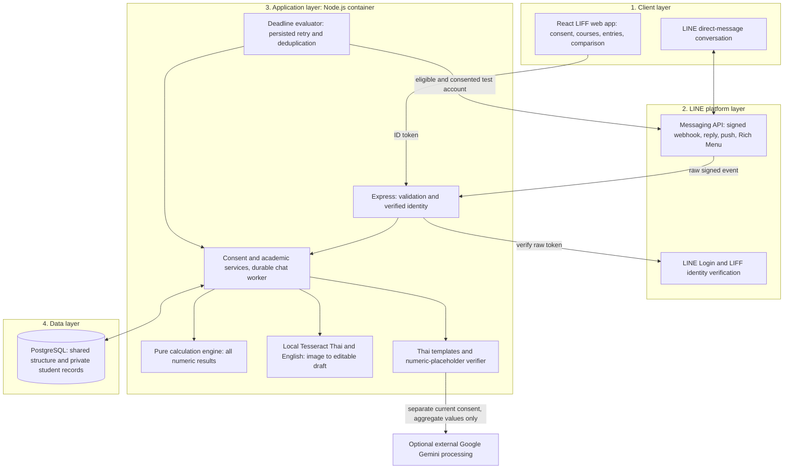

# Rord-Mai architecture

Release candidate: 30 October 2026. This describes the implemented system. Team review and same-release hosted acceptance remain pending.

The four logical layers follow the project proposal. The LIFF browser sends authenticated REST requests directly to Express; LINE mediates login and chat, not every web request. Tesseract runs inside the application container. Gemini sits outside the application boundary.

## Data flow and boundaries

1. LIFF obtains an ID token. Express verifies it through LINE and derives the student identity server-side. Login and consent reads alone create no student row.
2. Storage consent creates the private student identity. Separate external-explanation consent defaults off. Each consent operation uses a database transaction; withdrawing storage consent deletes private records.
3. Creating a section stores one shared structure and enrolls its creator. Joining reuses that structure. Scores and attendance are private to the verified enrollment owner.
4. Academic services load persisted inputs under student and section locks. The pure engine produces weighted totals, required scores and ordinary GPAX scenarios. The comparison delta is withdrawal minus staying, computed by the existing engine helper.
5. LINE verifies original webhook bytes before parsing. Consented events commit to a durable private queue before HTTP 200; processing and replies follow asynchronously. A consentless reminder remains request-local and is dispatched after acknowledgement without storing the message. Database acceptance and host cold starts can still delay acknowledgement.
6. OCR validates a single PNG/JPEG, invokes local Tesseract, removes temporary files and returns a draft. Only separate confirmed section creation persists it. Manual entry always remains available.
7. Explanation templates work without Gemini. Optional external calls send only aggregate computed metrics. Unknown placeholders, literal generated numbers, timeout and provider errors fall back to the template. Verified numbers do not establish linguistic accuracy.
8. Deadline evaluation rechecks eligibility and consent. Persisted retry keys and unique student/section records prevent repeated delivery. Hosted scheduling and phone receipt require separate evidence.

## Compatibility and deployment

The original `PUT /api/v1/consents` remains supported. New clients use the separate consent routes documented in `api/contract.md`. No schema migration is needed for the 30 October changes; migrations 001–006 remain unchanged. Startup awaits migrations before listening. Deployment, branch protections, clean-machine setup, actual hosting region and provider acceptance require operator evidence.

Repeated-course GPAX remains blocked with `REPEAT_RULE_UNVERIFIED`; stored previous-grade metadata is not an implemented replacement rule.
