# Rord-Mai: academic progress and withdrawal scenario comparison

Final-report candidate, 30 October 2026. Team: Chavadol Larat, Praweena Bunkham and Chuttiyaporn Pakdeeyut. **Participant UAT and same-release production acceptance are pending. This document must be completed with observed results before final submission.**

## Problem and objectives

Students need to combine assessment weights, recorded scores, remaining work and cumulative GPA when considering academic options. Rord-Mai presents these calculations inside LINE, with explicit assumptions and non-GPAX considerations. It supports decisions with estimates and does not recommend withdrawal or predict an official grade.

The core objective is an authenticated workflow for shared course setup, private score/attendance entry, required-score calculation and paired stay/withdraw GPAX comparison. Manual setup and deterministic Thai explanations keep the application usable without OCR or a language model.

## Implemented system

The four layers are the LIFF/chat client, LINE platform, application container and PostgreSQL data layer. The application separates Express identity/validation, consent-locked services, parameterised persistence and a pure calculation engine. See `architecture.md` for the implemented diagram and `api/contract.md` for interfaces.

Students choose storage and external explanations separately. Course structures are shared while academic entries remain private. Confirmed deletion removes private records and clears attribution without destroying classmates' shared structure. The data inventory lists every stored field and the remaining hosting-policy questions.

The 30 October candidate adds explicit weight shortfall/excess messages on creation and correction, separate consent endpoints with compatibility for the old route, post-acknowledgement consent reminders, a Recharts comparison, engine-produced numeric delta, a withdrawal-considerations panel, a separate optional second consent screen and Thai interface copy. HTTP verification tests use the production token verifier with controlled provider responses.

## System design figures

All figures use a consistent white background with black text, outlines and data-flow arrows. Shared typography and line styling follow the reference DFD, while each diagram retains its own notation.

The figures below describe repository baseline `639686b`, prepared on 1 November 2026. The [HTML diagram pack](diagrams/rord-mai-diagrams.html) provides selectable figures and individual SVG/PNG exports; the [combined PDF](diagrams/rord-mai-report-diagrams.pdf) contains 11 pages. The five DFD pages also have an [editable draw.io source](diagrams/rord-mai-dfds.drawio). These describe the implemented candidate and do not substitute for deployment, team review or participant UAT evidence.

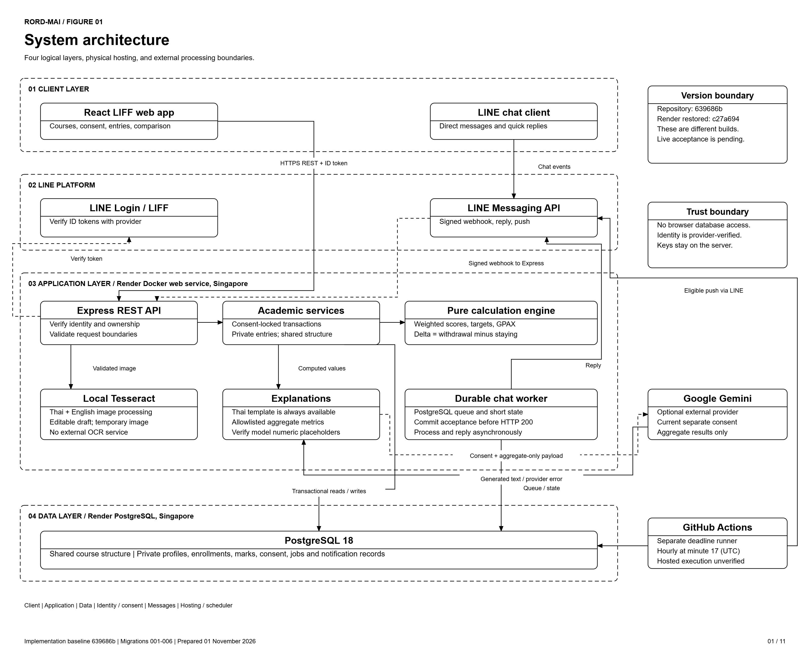

**Figure 1. System architecture.** The four logical layers are the LIFF/chat client, LINE platform, Node.js application and PostgreSQL. LIFF REST calls reach Express directly. Tesseract is local to the application container, Gemini is an optional external processor, and GitHub Actions runs the separate notification evaluator.

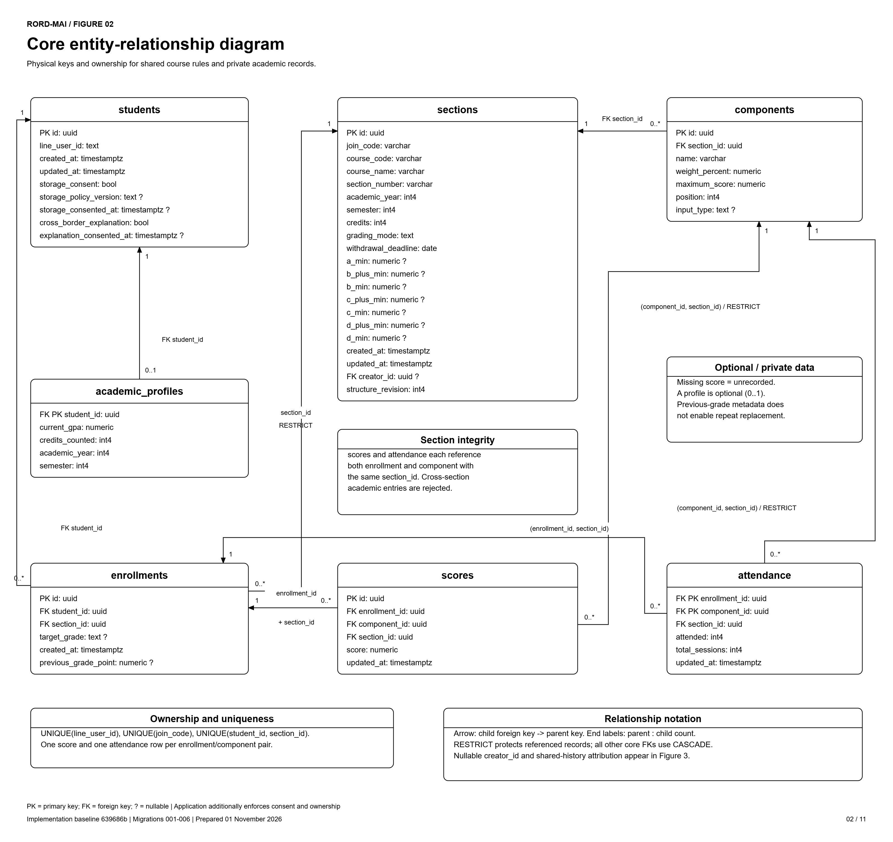

**Figure 2. Core ERD.** Shared sections and components are distinct from private enrollments, scores, attendance and academic profiles. Composite foreign keys force each score or attendance entry to reference an enrollment and component from the same section. Missing marks remain unrecorded rather than become zero.

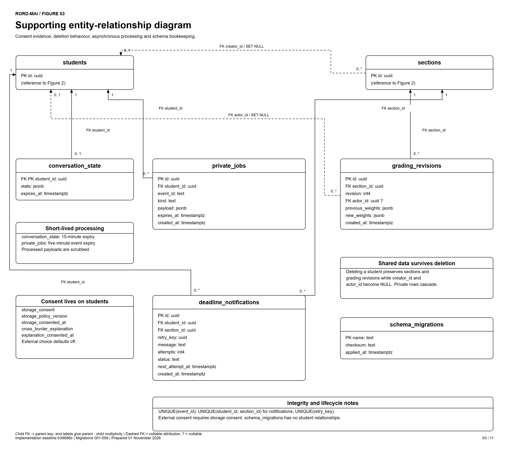

**Figure 3. Supporting ERD.** Consent evidence remains on students; supporting tables hold revisions, short-lived conversation/job data, notification delivery state and technical migration checksums. Figures 2 and 3 together cover all 12 tables, 89 columns and 15 foreign keys. Child-to-parent arrows and endpoint multiplicities distinguish required references from optional creator/actor attribution.

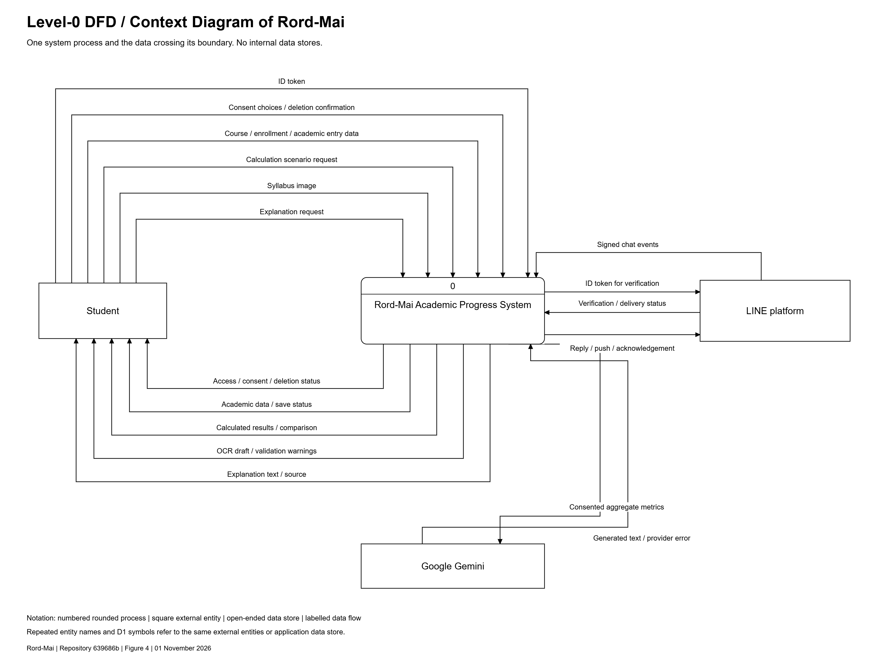

**Figure 4. Level-0 context DFD.** Students exchange academic inputs, consent choices, requests and results with process 0. LINE supplies identity verification, signed events and delivery responses; Gemini receives only consented aggregate metrics. The diagram uses the supplied monochrome reference style, shows no internal data store, and balances its external data flows with Level 1.

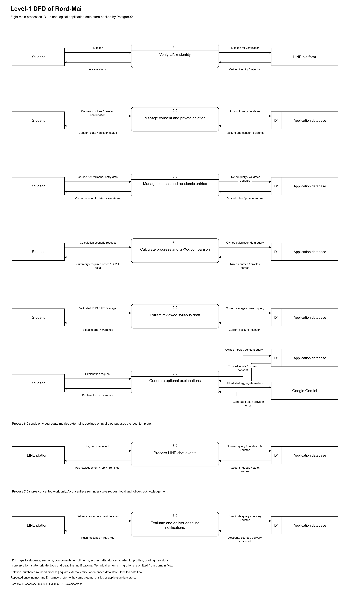

**Figure 5. Level-1 DFD.** Processes 1.0-8.0 cover identity, consent, academic records, calculations, local OCR, explanations, chat and deadline notifications. Repeated Student/LINE/Gemini entities and D1 store symbols are aliases. D1 is the logical domain data store backed by the actual PostgreSQL tables; it is not a new physical table. External entities never directly access it. Numbered process headers and open-ended stores distinguish the standard DFD symbols.

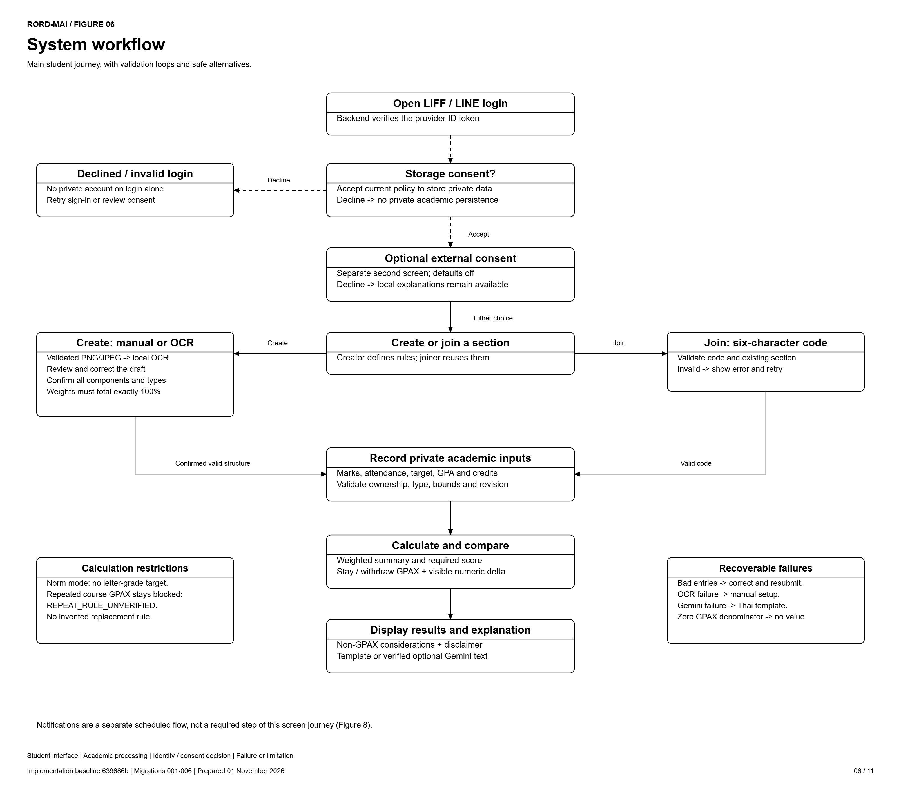

**Figure 6. System workflow.** The student authenticates, chooses storage and optional external consent, creates or joins a shared section, records private inputs and views estimates. OCR drafts require review and confirmation; invalid inputs return correction paths, model errors use templates, and repeated-course GPAX remains blocked.

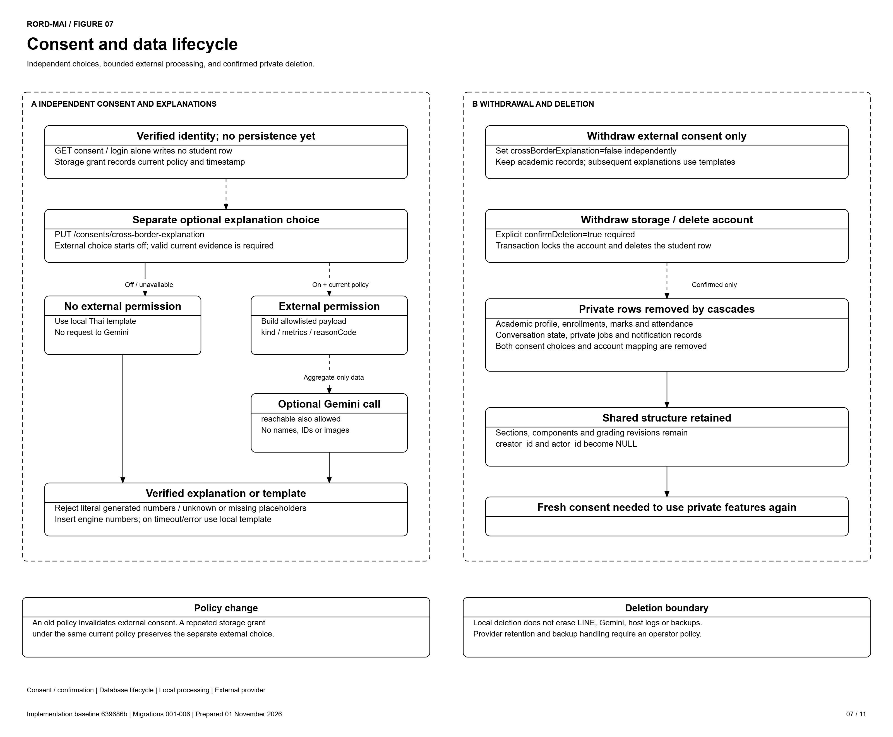

**Figure 7. Consent and data lifecycle.** Turning off external explanations preserves academic records. Confirmed storage withdrawal or account deletion removes private records, while shared structure/history survives with creator/actor attribution cleared. Database cascades do not erase provider records, hosting logs or backups.

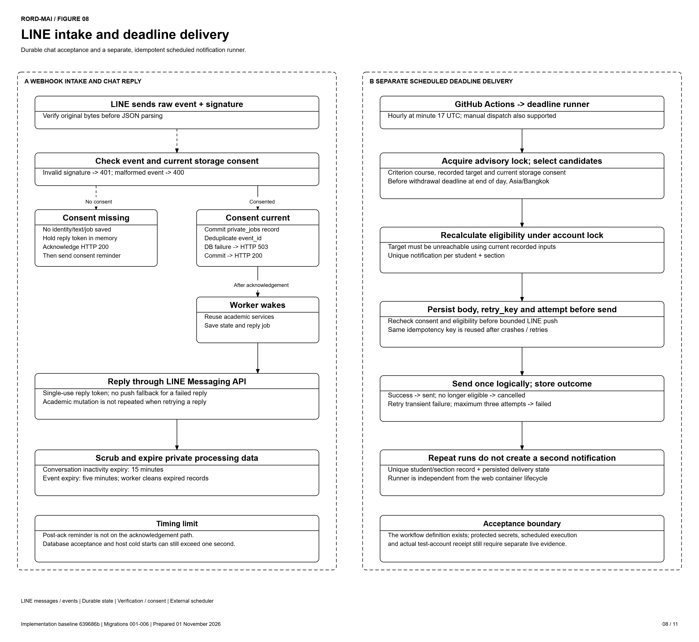

**Figure 8. LINE processing.** Consented work is committed before webhook acknowledgement; a consentless reminder is request-local and sent afterward. The independent scheduled runner rechecks eligibility and consent, persists retry keys before sending, and records outcomes to prevent duplicate notifications.

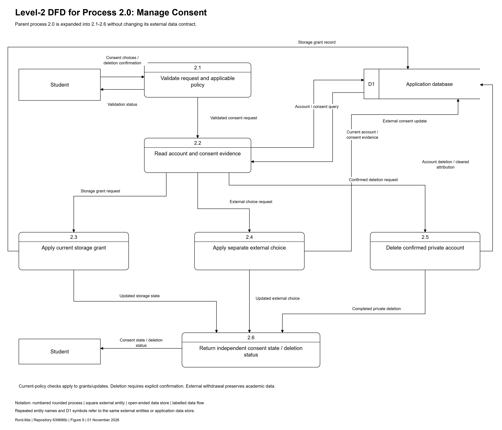

**Figure 9. Level-2 DFD for process 2.0.** Processes 2.1-2.6 validate consent requests, read current evidence, apply storage/external changes, perform confirmed private deletion and return state. The Student and D1 boundary data flows match process 2.0. Storage deletion is rooted at the student record; private cascades and cleared shared attribution follow the existing database relationships.

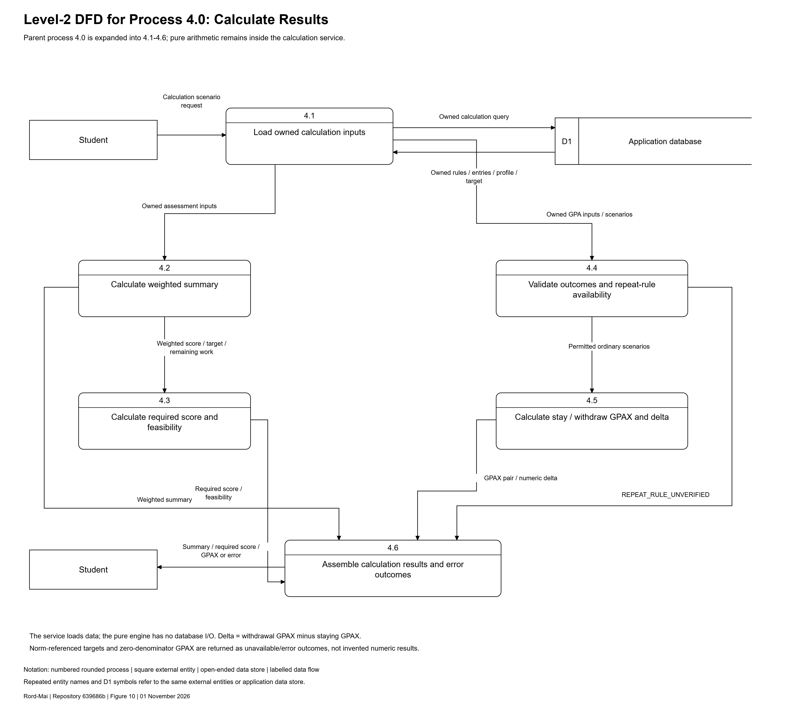

**Figure 10. Level-2 DFD for process 4.0.** Processes 4.1-4.6 load owned inputs, derive weighted totals and required scores, validate ordinary GPAX outcomes, compute the paired delta and assemble results. The service owns data access; the pure engine performs arithmetic. Repeated-course scenarios emit `REPEAT_RULE_UNVERIFIED`. The child preserves process 4.0's request, result, query and input interfaces.

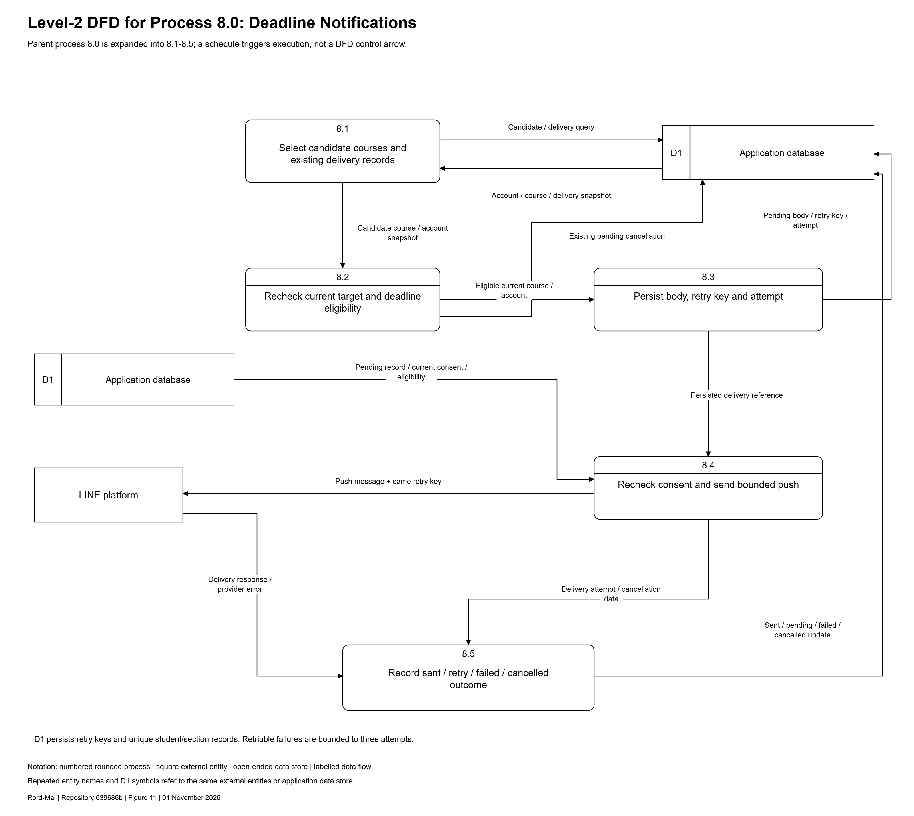

**Figure 11. Level-2 DFD for process 8.0.** Processes 8.1-8.5 select candidates, recheck eligibility, persist a retry key before delivery, recheck consent before the LINE push and record the outcome. Its D1 reads/updates and LINE push/response interfaces balance with process 8.0. The schedule triggers execution but is not drawn as a data-flow arrow.

**Hosted-version qualification.** On 1 November 2026 the older `c27a694` Render build was restarted with a new empty database; public health/readiness checks passed. The latest repository candidate was not deployed by that recovery. The full signed-in journey, real scheduled delivery and participant acceptance remain separate unrecorded results.

## Calculation example

For an 80/100 exam weighted 40%, current weighted points are `80/100 × 40 = 32`. Reaching an 80-point target with 60% remaining requires `(80 − 32)/60 × 100 = 80%` in the remaining work.

With cumulative GPA 3.00 over 30 counted credits and one assumed A in a 3-credit course, staying gives `(3 × 30 + 4 × 3)/(30 + 3) = 102/33 ≈ 3.09`. Withdrawal gives `90/30 = 3.00`; withdrawal minus staying is approximately `−0.09`. Full precision is preserved until display. These are fictional assumptions. A zero denominator produces no calculable GPAX.

## Verification method and results

Local verification uses API/HTTP tests, pure-engine boundary tests, a separate disposable PostgreSQL cluster, and phone/desktop browser tests with controlled LINE identity and native-OCR adapters. Controlled-provider tests are not live LINE/Gemini acceptance. Final counts and execution outcomes are recorded in the dated release evidence, `testing/release-2026-10-30.md`.

The deployed system test must use one published candidate and two real approved test accounts: create, join, record, calculate, compare, receive a notification, withdraw consent and delete. Record URL, build identifier, device, time and outcomes. **Observed result: not recorded for this candidate.**

## Participant UAT

Protocol: `testing/uat-protocol.md`. Observation template: `testing/uat-results-template.md`. Recruit 5–8 DME students with informed voluntary participation, fictional data and anonymised participant IDs. Record unaided success, assisted completion, attempts, duration and first failure step separately.

**Actual participants: not recorded. Task completion rates, failure frequencies, quotations and usability conclusions: not available.** Browser automation does not fill this evidence gap. Insert the actual observations and derived task denominators here after QA-07; do not convert planned participants into completed sessions.

## Limitations and remaining acceptance

Repeated-course GPAX is intentionally unavailable pending confirmation of the applicable official university rule. Previous-grade metadata is stored but does not establish grade-replacement behavior. A 2565 undergraduate regulation was located on an official KKU domain as a research candidate; applicability and the exact operative rule have not been established: https://iad.kku.ac.th/file/Announcement/Undergraduates_Regulations_2565_TH.pdf.

Free hosting may sleep, affecting cold-start and scheduled timing. Durable database acceptance can delay webhook acknowledgement, so the literal subsecond claim requires live measurements. Real LINE login, quick replies, Rich Menu registration, phone receipt, scheduling, current hosting configuration, branch protection, clean-machine setup and team review remain evidence gates.

OCR supports reviewed PNG/JPEG drafts, not PDF, and five real KKU syllabus photographs still require assessment. Gemini output uses trusted numeric placeholders and fallback but can still contain unsuitable language. Thai copy needs review by a person who did not write the screens. No generalisation or user-satisfaction claim is supported until UAT occurs.

## Conclusion

The candidate implements the main calculation and consent workflows and provides local verification evidence. Release acceptance depends on the same-release production test, real provider/container evidence and participant UAT. The final submission must distinguish working local behavior, observed deployed behavior and unresolved limitations.
